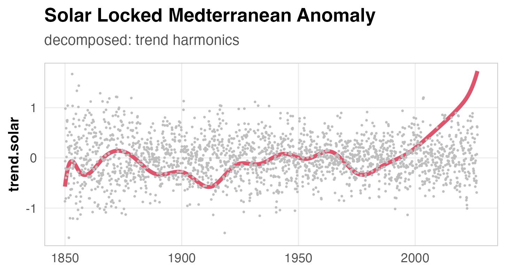
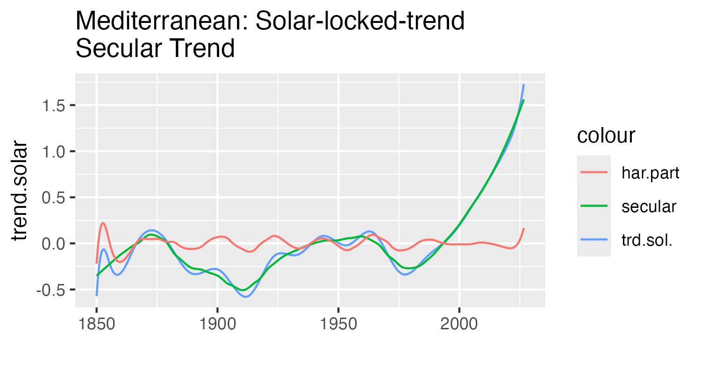
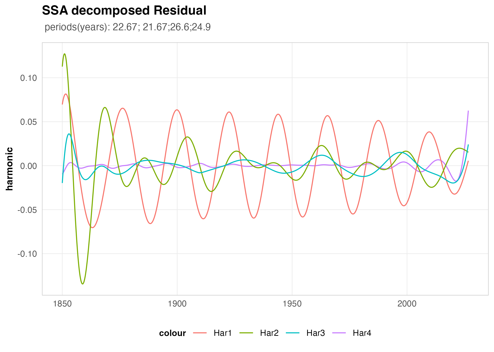

## Overview

A previous study of the periodic changes of the global oceans heat content can be modeled as a system of damped oscillators driven by periodic solar forcing. The dominant period was found to be approx. 20 years. The system got out of balance shown by a trend with very long periods. The objective of this study to extract the dominant oscillations and their interaction. Assuming the energy being stored as heat contend of mayor basins and dynamicly in huge vortices.

The dominant modes to be extracted as quasi harmonics by modal analysis.

```{r setup}
#| include: false

library(tidyverse) 
library(here)
library(zoo)
library(terra)
library(Rssa)
library(knitr)
library(kableExtra)


# Define global plot appearance
theme_set(
  theme_minimal(base_size = 11) +
    theme(
      # Typography
      plot.title = element_text(face = "bold", size = 13, margin = margin(b = 6)),
      plot.subtitle = element_text(color = "grey30", size = 10, margin = margin(b = 10)),
      axis.title = element_text(face = "bold", size = 10),
      
      # Grid & Background
      panel.grid.minor = element_blank(),
      panel.grid.major = element_line(color = "grey92", linewidth = 0.3),
      
      # Legend positioning
      legend.position = "bottom",
      legend.title = element_text(face = "bold", size = 9),
      
      # Clean frame borders
      panel.border = element_rect(color = "grey80", fill = NA, linewidth = 0.5)
    )
)

```

### planed workflow

1.  extract regional data from ocean grid weighted values into regional stack
2.  summarize as regional time series
3.  determine trend and dominant harmonics of mayor basins
4.  SSA decomposition
5.  fit logistic and/or Richards to separate effect of non balanced radiation (irradiation input-long wavelength output )
6.  search resonances with solar periods
7.  Modal analysis to separate dominant modes and potential resonances

### modified workflow

Fundamental Achilles' heel of applying blind, high-dimensional SSA (like retaining 40 components) to regional sub-basins: **SSA decomposes variance, not physical mechanisms.** The Mediterranean has strong interannual red noise and a high-amplitude seasonal cycle. Rssa requires white noise.This is not achieved with changing the window length $L$ alone. This causes physical signals to smear across eigenvectors, making high-component reconstructions unstable, wiggly, and critically dependent on $L$.

Possible solution— 1. **pre-locking the raw data to the solar irradiation *before* running SSA, and then decomposing the solar-locked trend versus the solar-locked residuals**

2.  **Stabilizes the Sigmoidal/Richards Fitting:**

Locking the secular trend should give a clean, monotonic baseline to fit growth curves without artificial oscillations. 3. **Physically Meaningful Residuals:** Decomposing the solar-locked residuals separately allows to isolate regional internal dynamics (like Mediterranean overturning, evaporation-precipitation balances, and NAO-driven heat storage) without the solar forcing "double-dipping" into both trend model and oscillatory components.

### Recommended Implementation Steps in R

1.  **Step 1: Solar-Locking / Baseline Removal**

2.  **Step 2: Conservative SSA on Residuals** Run `ssa()` on the cleaned residuals using a stable window length (e.g., $L = 480$ or $L = 360$) Because the massive secular trend is removed, the eigenvalue spectrum will be much better behave, and the W-correlation matrix will show cleaner, block-diagonal separation of internal multi-decadal cycles.

3.  **Step 3: Growth Curve Fitting** Fit logistic and Richards growth model exclusively to the time series cleaned from seasonal effects.

```{r data}
#| echo: false
#| include: false
#| warning: false
source("Scripts/Medi_anomaly.R")


```


{#fig-locked-trend} Notes:

1.  Starting \~1975 the trend rises continuous but with changing slope. A first acceleration of the rise around 2000 and a second \~2010\
2.  From 1850 to 1950 the trend is oscillating around mean value with no significant rise.

The residual @fig-locked-trend monthly values shown as grey dots is decomposed using SSA. The correlation matrix shows 3 sharp separated dominant pairs (named:Base, Har2, Har3) and a fourth group of 4 strong correlated components Har4. The dominant base harmonic and Har4 are a quasi harmonics with periods of 12.1 and 11.9 month.

```{r print periods}
#| echo: false
natr.harmonics = pe_tibble %>%
  mutate(
    periods = round(periods, 1),
    moduli  = round(moduli, 3),
    rates   = round(rates, 5)
  ) 

natr.harmonics %>%
  kable(
    format = "markdown",
    col.names = c("Component", "Period (mo)", "Modulus", "Rate"),
    caption = "Estimated parameters for SSA oscillatory components."
  )
```

Har2 has a period of 4 years and Har3 of 5.8 years. The 5.8 years resonance corresponds well with the average 5.7 years period detected with a simple model of ENSO oscillation @burgers2005simplest

The itsmr package @brockwell2016introduction was applied to eliminate seasonal effects. As seen from the SSA decomposed data components base and Har4 this is indeed not working on non stationary time series.

The Mediterranean time series is not stationary The reconstructed dominant residual exhibit high frequency periods (base and full) are stationary up to 1975.

Hence a different method has to be used to separate the harmonic components from the natural anomaly.

1.  *Richards Curve Fitting & Asymptote*

- Parameter Adjustments: Moving from a simple logistic curve to the Richards curve shifted the upper asymptote up to \~2.3.\
- Asymmetry and Shape: By keeping the symmetry point fixed at 2014 and introducing the shape parameter $\nu =1.2$, the Richards curve accommodates a slightly more flexible, asymmetric approach to the inflection point compared to a standard symmetric sigmoid. This takes care of the physical effect of the radiative inbalance and the limiting factors (clouds,atmospheric vapor content ) being much different.

2.  *Gleisberg Cycle and SSA Reconstruction*

- Multi-Decadal Oscillation: The smoothed blue trend line clearly exhibits a long-term wavy modulation that aligns with the Gleisberg solar cycle (\~80 to 90-year periodicity).\
- Component Grouping: Reconstructing the trend using a correlation matrix of the first 3 SSA components successfully filters out high-frequency noise while preserving this major multi-decadal cycle.

3.  Structural Breaks & Regime Shifts \* Vertical Dashed Lines: The changepoints identified via rolling correlation (highlighted by the vertical dashed lines in the latter half of the timeline) successfully capture the sharp post-1980s/1990s acceleration in warming trends.

- This lines up with known Mediterranean "regime shifts" in marine heat content and stratification?

\*. The correlation break of the global ocean is approx 40 years earlier then found with the Mediterranean

Gemini suggested the \~40-year phase lag provides a clean physical narrative:

Global SST: Early structural break (\~1950) driven by low average mixed-layer inertia across broad tropical oceanic regions.Semi-Enclosed / Deep-Convection Basins (Med): Delayed structural break (\~1990) due to deep-water heat storage and strong atmospheric masking, proving that local $h_{ml}$ acts as a buffer before surface signature bifurcation occurs.

```{r}
#| include: false
#| echo: false
#| warning: false
source("Scripts/Medi_sol_ssa_decmp.R")

```

{#fig-medi-trd fig-align="center" width="85%"}

{#fig-medi-resds fig-align="center" width="85%"}

Key Observations & Physical Interpretation1. The Residual Mode Clustered Around \~22–26 YearsSpectral Clustering: The extracted periods in the residual ($22.67$, $21.67$, $26.6$, and $24.9$ years) sit in an extraordinarily narrow frequency band centered right around the \~22-year Hale solar magnetic cycle and the bi-decadal ocean-atmosphere modes.Beating and Phase Interference: Looking at those four extracted periods, it is immediately clear why a single-step direct SSA or Fourier decomposition produced severe interference artifacts. When multiple sub-signals with frequencies so close together ($21.7 \text{ yr}$ vs. $22.7 \text{ yr}$ vs. $24.9 \text{ yr}$ vs. $26.6 \text{ yr}$) are analyzed simultaneously in the full raw anomaly, their beat frequencies (modulations on $\Delta f^{-1} \approx 100\text{--}200\text{ year}$ scales) mimic non-stationary amplitude modulation. Pre-filtering/locking the solar trend prevents those low-frequency modulation artifacts from bleeding into the high-frequency residual reconstructions.2. Physical Separation in the TrendThe solar-locked trend (Plot 1) neatly captures the long-term non-linear baseline acceleration along with the distinct low-frequency cycles ($91\text{ yr}$ Gleissberg-scale solar modulation, $41\text{ yr}$, $32\text{ yr}$, and $24\text{ yr}$).By setting $L = N/3$ (with $N \approx 176$ years from \~1850 to 2026, so $L \approx 58\text{--}59$ window length), the trajectory matrix window length is broad enough to cleanly resolve the $30\text{--}90$ year multidecadal modes without over-splitting the long-term warming trajectory into spurious edge sinusoids.3. Boundary / Edge DynamicsNote the characteristic SSA endpoint artifacts near 1850 and 2026 (particularly in Har2 of the residual plot). Since SSA relies on symmetric lag-covariance estimation, the effective windowing at the boundary creates brief amplitude flares at the series boundaries. However, across the stable interior (1870–2010), Har2 and Har3 exhibit extraordinarily stable amplitude coherence.

$$ \hat{f}(t) = 2 \cdot e^{-0.06 t} \left[ 0.99 \cos\left(\frac{2\pi}{5.80} t + 0.09\right) - 0.09 \sin\left(\frac{2\pi}{5.80} t + 0.09\right) \right] $$
